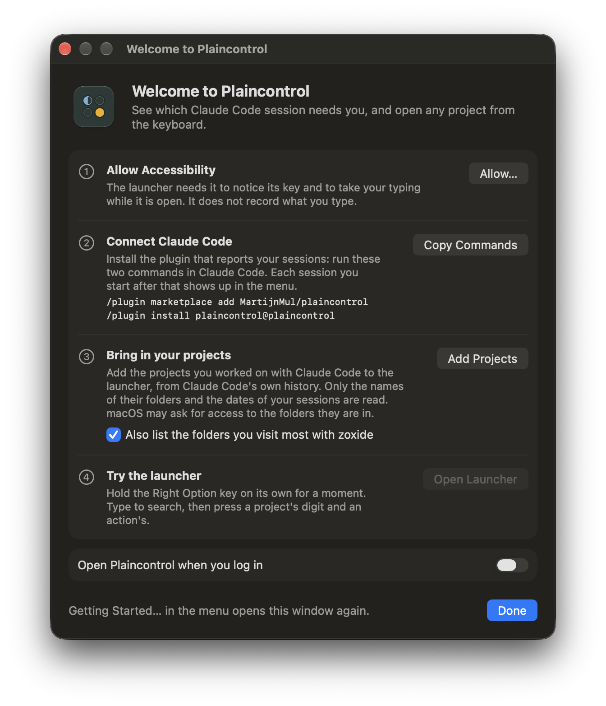

<p align="center"></p>

<h1 align="center">Plaincontrol</h1>

<p align="center"><strong>See which session needs you.</strong><br>A macOS menu bar app for running several Claude Code sessions at once.</p>

<p align="center">
  <a href="https://github.com/MartijnMul/plaincontrol/releases/latest"></a>
  <a href="LICENSE"></a>
  
</p>

<p align="center"></p>

- **See every session** in the menu bar, with the ones waiting on you counted and listed first.
- **Get a notification** when a session finishes or asks you something.
- **Jump to it** in one click: its window, tab and pane come to the front in iTerm2 or Terminal, on any Space.
- **Open any project from the keyboard**: hold the right Option key, pick a project, and start Claude Code, a terminal, your editor or its dev server, in a free spot on your screens.

> **Early days.** It works, with rough edges. Jumping to sessions and opening terminals work in iTerm2 and Terminal only so far. Settings may still change; the [changelog](CHANGELOG.md) says when.

## Install

Needs macOS 26 or later and [Claude Code](https://code.claude.com). Three steps, in this order.

### 1. Install the app

Either with [Homebrew](https://brew.sh):

```sh
brew install --cask martijnmul/tap/plaincontrol
```

Or download [`Plaincontrol.dmg`](https://github.com/MartijnMul/plaincontrol/releases/latest/download/Plaincontrol.dmg), open it and drag Plaincontrol to Applications.

### 2. Open it

Open **Plaincontrol** from Applications or Spotlight. A welcome window walks you through the rest: allowing **Accessibility**, which the launcher needs, connecting Claude Code (step 3 below), adding the projects you already worked on with Claude Code, and opening Plaincontrol when you log in. After that it has no window and no Dock icon: it lives in the menu bar, at the top right of your screen, where Getting Started… opens the welcome window again.

<p align="center"></p>

The first time you jump to a session, macOS asks whether Plaincontrol may control your terminal (iTerm2 or Terminal): allow that too.

### 3. Connect Claude Code

In Claude Code, run:

```
/plugin marketplace add MartijnMul/plaincontrol
/plugin install plaincontrol@plaincontrol
```

The sessions you start from then on show up in Plaincontrol's menu. Without the plugin, the launcher still works, but Plaincontrol sees no sessions: no list and no notifications.

### Try it

Hold the **right Option key** on its own for a moment: the launcher opens. [The launcher](#the-launcher) below explains the rest.

**Updates**: with Homebrew, `brew upgrade`. Either way, Plaincontrol asks on its second launch whether to update itself.

**Uninstall**: quit Plaincontrol and run `brew uninstall --cask plaincontrol`, or drag it to the Bin; then run `/plugin uninstall plaincontrol@plaincontrol` in Claude Code. Your settings and history are in `~/.config/plaincontrol` and `~/Library/Application Support/Plaincontrol`; `brew uninstall --cask --zap plaincontrol` removes them too.

## The launcher

Hold the right Option key on its own, or choose Open Launcher in the menu. Type to search, then press a project's digit; in a project, press an action's digit. Arrows and Return work too; Escape goes back, then closes.

<p align="center"></p>

| Key | Action |
| --- | --- |
| 1 | Claude Code in the Claude desktop app, in a new window |
| 2 | A terminal in the project's folder |
| 3 | The folder in Finder |
| 4 | The folder in your editor |
| 5 | Claude Code in a new terminal window |
| 6 | The dev server, when the project has one |

So **4** then **5** starts Claude Code in the fourth project. Actions for apps you don't have are left out. **←** on the list of projects opens an empty window of your terminal, browser or Finder instead.

- **Projects** come from where you use Claude Code and the launcher, most used first, and from [zoxide](https://github.com/ajeetdsouza/zoxide) if you use it. Nothing to set up.
- **The dev server** is `make dev`, the `dev` script in `package.json`, `make run` or `docker compose up`, whichever the project has first. Set your own per project in the settings. When the launcher knows the port, it asks whether to open the page in your browser too.
- **Apps**: the terminal and editor you use most, and your default browser, until you choose others in the settings.
- **New windows** go in columns across your screens, like a window manager, starting with the screen under the pointer. The settings set the columns, or turn it off.

## Settings

Settings… in the menu (Command-comma). Every setting shows whether it is at its default and can be reset. They are stored in `~/.config/plaincontrol/settings.yaml`, which you can also edit by hand, from Edit as Text… in Settings › Advanced, or keep in your dotfiles; the window keeps your comments, and a schema next to it gives completion in editors with the YAML language server.

<p align="center"></p>

## Privacy

Plaincontrol sends nothing about you off your Mac. Its one network request is the update check, and only if you allow it.

- Of each Claude Code event it keeps only the session, its folder, its status and its terminal pane. Prompts are never stored or logged.
- The Accessibility permission lets it notice the launcher key and take your typing while the launcher is open, and move the windows it opens. It does not record what you type.
- Your launcher history stays in `~/Library/Application Support/Plaincontrol`. zoxide's data is only read.
- Adding your projects from Claude Code's history, in the welcome window, reads only the names of the folders in `~/.claude/projects` and the dates of the session files in them, never what is in those files.
- On its second launch, Plaincontrol asks whether to check for updates automatically. If you agree, it asks GitHub once a day for the latest version, which tells GitHub your IP address and Plaincontrol's version, as any download from GitHub does. Change your mind in Settings.

[SECURITY.md](SECURITY.md) has the details, and how to check that your copy is genuine.

## Contributing

Bug reports, ideas and pull requests are welcome. [CONTRIBUTING.md](CONTRIBUTING.md) explains how to build it and work on it.

## License

[Apache License 2.0](LICENSE). Plaincontrol is an independent project, not affiliated with or endorsed by Anthropic. Claude and Claude Code are trademarks of Anthropic.
